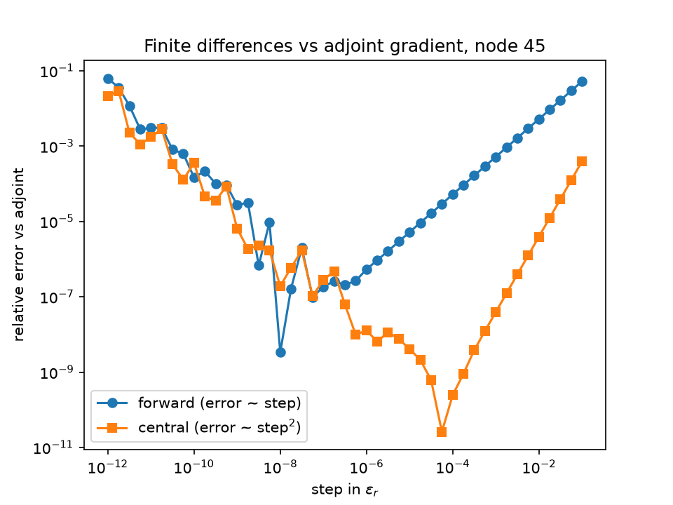
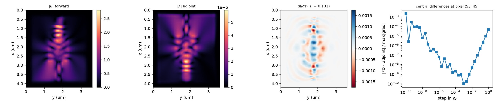

# Adjoint gradient

**Setup.** $A(\varepsilon_r)\,u = b$ with $A$ of shape $N\times N$. The objective is $J = |a|^2$, where $a = c^Hu$ is a complex scalar and $c$ is an $N$-vector of probe weights (conventions.md, item 4). For example, $c = e_m$ reads $u_m$.

**Eq. 1.** Only the diagonal of $A$ depends on $\varepsilon_{r,i}$, through $k_0^2\varepsilon_{r,i}$ (fdfd1d.md, Eq. 2; the PML terms do not depend on $\varepsilon_r$):
$$\frac{\partial A}{\partial\varepsilon_{r,i}} = k_0^2\,e_ie_i^T .$$

**Eq. 2.** $J$ is real, so (conventions.md, item 6)
$$dJ = 2\,\mathrm{Re}\Big(\sum_j g_j\,du_j\Big) = 2\,\mathrm{Re}(g^T du),\qquad g_j = \frac{\partial J}{\partial u_j}\ (\bar u \text{ held fixed}).$$

**Eq. 3.** $J = a\bar a$ with $a = \sum_j\bar c_ju_j$ and $\bar a = \sum_j c_j\bar u_j$. Holding $\bar u$ fixed, only $a$ changes, so $\partial J/\partial u_j = \bar a\,\bar c_j$:
$$g = \bar a\,\bar c .$$

**Change of $u$.** Differentiate $Au = b$; $b$ does not depend on $\varepsilon_r$:
$$dA\,u + A\,du = 0\quad\Longrightarrow\quad du = -A^{-1}dA\,u .$$

**Eq. 4, the adjoint field.** Put $du$ into Eq. 2:
$$g^Tdu = -g^TA^{-1}dA\,u = -(A^{-T}g)^T dA\,u .$$
Define $\lambda$ by
$$A^T\lambda = g .$$
Then $g^Tdu = -\lambda^T dA\,u$. One solve gives $\lambda$, whatever $dA$ is.

**Eq. 5, the gradient.** With $dA = k_0^2e_ie_i^T\,d\varepsilon_{r,i}$ (Eq. 1), $\lambda^TdA\,u = k_0^2\lambda_iu_i\,d\varepsilon_{r,i}$, so
$$\frac{dJ}{d\varepsilon_{r,i}} = -2k_0^2\,\mathrm{Re}(\lambda_i u_i).$$
Cost: one LU factorization, then one forward and one transposed solve, for all $N$ gradient entries.

**Physical picture.** $\lambda$ is the field of a source $g$ placed at the probe, sent back into the device. $\lambda_iu_i$ is large where the forward wave and the wave from the probe overlap.

**What goes wrong with the wrong transpose (measured).**
- **$A$ instead of $A^T$.** The gradient is wrong *only in the PML*. Write $A^{-1} = (SA)^{-1}S$ with $SA$ symmetric. Then $A^{-T} = S(SA)^{-1}$, so $\lambda_{A^T} = S\,\lambda_A$ whenever $Sg = g$ (the probe is outside the PML). $S = 1$ outside the PML, so the two agree there. Lesson: the finite-difference check must sample some PML nodes, or this bug passes. In 2D, a mode monitor spans the whole line, PML included, so $Sg \ne g$ and the bug leaks into the physical region too, but only at the size of the mode's tail in the PML: measured $8\times10^{-8}$ of $\max|dJ/d\varepsilon_r|$ inside the design block, against 13% at pixels in the PML. So the 2D check samples four PML pixels as well.
- **$A^H$ instead of $A^T$.** The gradient is wrong everywhere (110% error in our test). Conjugating flips the PML from absorbing to amplifying, and the solve is global.

**Finite differences.** Use central differences:
$$\frac{J(\varepsilon_{r,i}+\Delta)-J(\varepsilon_{r,i}-\Delta)}{2\Delta}.$$
The truncation error is $O(\Delta^2)$, against $O(\Delta)$ for forward differences. The V plot  shows central differences reaching $10^{-10}$ at $\Delta\approx10^{-4}$, where forward differences only reach $10^{-7}$. The test uses $\Delta = 10^{-4}$ and a tolerance of $10^{-6}$ relative to $\max_i|dJ/d\varepsilon_{r,i}|$.

### 2D, and what stays fixed

**The same formulas in 2D.** Flatten $u$, $\varepsilon_r$, $b$ and $c$ in C order (conventions.md, item 3). $A = L + k_0^2\,\mathrm{diag}(\varepsilon_r)$ (fdfd2d.md, Eq. 2), so Eq. 1 holds with $i$ the flattened pixel index, and Eqs. 2 to 5 are unchanged.

**$b$ does not depend on $\varepsilon_r$.** The derivation of Eq. 4 assumed this. For the one-way mode source (modes.md, Eq. 5), write $A = L + D$ with $D = k_0^2\,\mathrm{diag}(\varepsilon_r)$. $D$ and $Q$ are both diagonal, so $DQ = QD$, and
$$AQ - QA = (L+D)Q - Q(L+D) = LQ - QL .$$
The commutator only sees $L$. The profile $e$ is computed once, from the undisturbed input guide, and held fixed. So $\partial b/\partial\varepsilon_r = 0$ (measured: changing every $\varepsilon_r$ changes $b$ by $4\times10^{-16}$ relative). The monitor $c$ is also fixed (modes.md, Eq. 6). **Assumption:** in an optimization, the source and monitor lines sit in the access guides, outside the design region.

### Reciprocity and time reversal

**Reciprocity: the adjoint problem is the same device, with the source at the monitor.** $SA$ is symmetric (fdfd2d.md, Eq. 3), so $(SA)^T = A^TS = SA$, which gives $A^T = SAS^{-1}$. Then
$$A^T\lambda = g\iff SAS^{-1}\lambda = g\iff A\,(S^{-1}\lambda) = S^{-1}g .$$
So $S^{-1}\lambda$ is the field that the *ordinary forward solver* produces from the source $S^{-1}g$. Outside the PML, $S = 1$: $\lambda$ is the field radiated by a source $g$ placed at the monitor, in the same device. This is reciprocity, $G(\mathbf r_1,\mathbf r_2) = G(\mathbf r_2,\mathbf r_1)$ (electrodynamics.md, "Reciprocity"), and it is why the adjoint is "a wave sent back from the detector".

**Time reversal: the adjoint source is the conjugate of the wanted output.** Under $e^{-i\omega t}$, the physical field is $\mathrm{Re}(u\,e^{-i\omega t})$. Conjugating $u$ gives
$$\mathrm{Re}(\bar u\,e^{-i\omega t}) = \mathrm{Re}(u\,e^{+i\omega t}),$$
the same field with $t\to-t$. So **conjugation is time reversal**. In a lossless region, $\bar u$ solves the same equation, because $A$ has real coefficients there. The adjoint source is $g = \bar a\,\bar c\propto\bar e$ on the monitor line (Eq. 3). That is the conjugate of the mode we want to arrive, so it sends the time-reversed wanted output back into the device.

**Picture, not a theorem.** The gradient $-2k_0^2\,\mathrm{Re}(\lambda_iu_i)$ (Eq. 5) is large where the forward wave and this backward wave overlap: the places where a change of $\varepsilon_r$ best converts what arrives into what we want. The PML is not time-reversible: conjugating turns absorption into gain. That is why $A^H$, which conjugates the whole operator, is wrong, while $A^T$ is right.

**Figure.** `scripts/adjoint_2d.py` makes `docs/figures/adjoint_2d.png`. Its panels show $|u|$, then $|\lambda|$ (it enters from the monitor side), then $dJ/d\varepsilon_r$, then the 2D V plot at one pixel.

