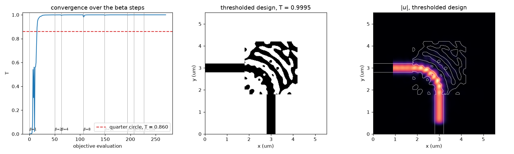

# A 90-degree bend

This page optimizes a 90-degree waveguide bend with the full chain of [topopt.md](topopt.md): filter, projection, adjoint gradient. The script is `scripts/optimize_bend.py`. The problem is set up in `adjoint_helmholtz/bend.py`.

## Setup

The guides are Si ($\varepsilon_r = 12.1$) in SiO₂ ($\varepsilon_r = 2.1$) at $\lambda = 1.55$ µm. Both guides are 0.4 µm wide. The input guide enters a 2.4 µm × 2.4 µm design region from the left (along $+x$). The output guide leaves it from the bottom (along $-y$). The guide axes cross at the centre of the design region. The grid step is $h = 0.02$ µm, so the full grid is 276 × 276 nodes with 0.8 µm of PML on each side, and the design grid is 120 × 120 pixels. A one-way mode source launches the input guide's fundamental mode with amplitude 1. $T$ is the power in the output guide's fundamental mode, measured by a mode-overlap monitor ([modes.md](modes.md)). The conic filter has radius $R = 0.1$ µm (5 pixels). The projection threshold is $\eta = 0.5$. The design starts at a uniform $\rho = 0.5$. The optimizer is L-BFGS-B with bounds $0 \le \rho \le 1$. Continuation runs through $\beta = 1, 2, 4, 8, 16, 32, 64, 128$, with at most 40 L-BFGS-B iterations per step. Each step starts from the previous step's $\rho$.

The baseline is a quarter-circle guide of the same width, centred on the bottom-left corner of the design region. Its radius is 1.2 µm, so it joins both straight guides on their axes.

## Results

| Design | $T$ |
|---|---|
| Quarter circle (baseline) | 0.8603 |
| Optimized, continuous ($\beta = 128$) | 1.0000 |
| Optimized, thresholded at 0.5 | 0.9995 |

| $\beta$ | $T$ | Binary fraction | Evaluations | Time (s) |
|---|---|---|---|---|
| 1 | 0.9996 | 0.063 | 50 | 27 |
| 2 | 0.9998 | 0.097 | 13 | 7 |
| 4 | 0.9999 | 0.244 | 44 | 23 |
| 8 | 0.9999 | 0.546 | 42 | 22 |
| 16 | 0.9999 | 0.771 | 45 | 24 |
| 32 | 0.9999 | 0.883 | 13 | 7 |
| 64 | 0.9999 | 0.942 | 20 | 10 |
| 128 | 1.0000 | 0.969 | 44 | 23 |

The binary fraction is the share of pixels of $\rho_p$ within 0.05 of 0 or 1. An evaluation is one forward solve plus one adjoint solve. The number of evaluations differs from the number of iterations because the line search can call the objective more than once per iteration, and L-BFGS-B can stop before 40 iterations when it converges. The whole run takes 271 evaluations and about 2.5 minutes.

Left: $T$ at every objective evaluation, with grey lines at the start of each $\beta$ step. Middle: the design thresholded at 0.5 (black is Si). Right: $|u|$ for the thresholded design, with the Si boundary in white.

## Findings

**$T$ is already 0.9996 at $\beta = 1$, with a gray design.** Only 6% of the pixels are binary at that point. With the Si/SiO₂ contrast, this bend is an easy problem for the optimizer. The continuation is almost entirely about making the design binary without losing $T$. $T$ dips briefly at the start of some steps (most visibly at $\beta = 8$), when the sharper projection changes the design, and recovers within a few evaluations.

**The 95% binary target needs $\beta = 128$.** At $\beta = 64$ the binary fraction is 0.942. The gray pixels that remain sit on the edges of the many small features. A larger filter radius gives fewer, larger features with less edge, so it would likely reach the target at a smaller $\beta$.

**Thresholding costs 0.0005 in $T$** (1.0000 → 0.9995). The cause is the 3% of pixels that were still gray at $\beta = 128$.

**The design grows stripes on the outer side of the bend, plus a few isolated dots.** One reading (an interpretation, not tested): the stripes act like a Bragg reflector that keeps light on the inside of the turn. Nothing in $T$ penalizes stripes or dots, so the optimizer keeps them. Removing them needs a length-scale or connectivity constraint.

**The quarter circle loses 14%.** The likely causes are radiation at a radius as tight as 1.2 µm and mode mismatch where the curve meets the straight guides (an interpretation, not tested).
